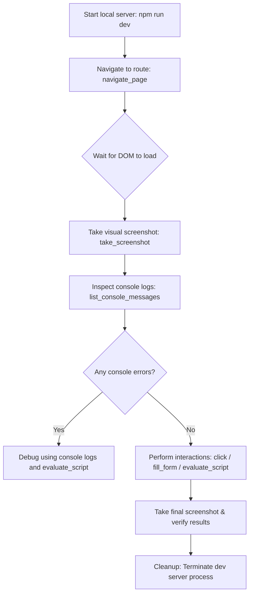

# Epiroc Chrome DevTools Skill

This skill provides guidelines and best practices for browser automation, DOM inspection, visual QA, and interactive testing of Epiroc Web Applications using the Chrome DevTools MCP server.

## When to use this skill

- To visually verify frontend changes (React components, layouts, CSS transitions, themes).
- To interact with dynamic Single Page Applications (SPAs) such as Logistech (filling forms, clicking buttons, triggering events).
- To inspect page logs, network activity, and console errors to debug client-side failures.
- To execute complex visual and accessibility audits (Lighthouse).
- **MANDATORY**: Activates whenever you need to perform end-to-end frontend verification or visually confirm UI fixes.
- Trigger keywords: `chrome-devtools`, `chrome`, `browser`, `navegar`, `click`, `screenshot`, `captura`, `console`, `network`, `devtools`, `navegacion`

## 1. Available Tools Mapping

The Chrome DevTools MCP server exposes several key tools. Use them according to these specific scenarios:

| Tool Name | Core Purpose | Typical Arguments |
|-----------|--------------|-------------------|
| `navigate_page` / `navigate` | Load a specific URL/route in the active browser context | `{"url": "http://localhost:5173/admin/users"}` |
| `evaluate_script` / `evaluate` | Execute client-side JavaScript in the page context | `{"script": "document.title"}` |
| `take_screenshot` | Capture a visual image of the current page viewport | `{"ImageName": "screenshot_name"}` |
| `list_console_messages` | Retrieve log entries printed to the browser console | N/A |
| `list_network_requests` | Check HTTP/HTTPS requests triggered by the client | N/A |
| `fill_form` | Autofill input fields in a form element | `{"selector": "#user-form", "data": {...}}` |
| `click` | Simulate a click event on a DOM element | `{"selector": "button.submit"}` |
| `take_snapshot` | Inspect the page structure or accessibility tree | N/A |

---

## 2. Secure Client-Side Scripting (JS Injection)

When executing JavaScript using `evaluate_script`, you must ensure safety and robustness. Single Page Applications (Vite + React) load asynchronously. Adhere to the following rules:

### Rule A: Safe Execution with Try-Catch
Never run bare JS calls that could fail silently or crash. Always wrap interactive operations in a `try-catch` block:

```javascript
try {
  const submitButton = document.querySelector('button[type="submit"]');
  if (!submitButton) {
    return "Error: Submit button not found in current DOM.";
  }
  submitButton.click();
  return "Success: Clicked submit button.";
} catch (e) {
  return "Error during interaction: " + e.message;
}
```

### Rule B: Wait for Elements (Async Handling)
SPAs do not reload the page on route changes. You must introduce dynamic checks or wait for key elements to appear before performing actions:

```javascript
// Wait for a element to load (check up to 5 seconds)
async function waitForElement(selector, maxWaitMs = 5000) {
  const start = Date.now();
  while (Date.now() - start < maxWaitMs) {
    const el = document.querySelector(selector);
    if (el) return el;
    await new Promise(resolve => setTimeout(resolve, 200));
  }
  throw new Error(`Timeout waiting for element: ${selector}`);
}
```

### Rule C: Avoid Token Exhaustion (DOM Truncation)
Extracting the entire DOM (`document.documentElement.outerHTML`) on modern web pages can return megabytes of text, wasting tokens.
- **Do not query `outerHTML`** unless absolutely necessary.
- **Prefer querySelector** to isolate content:
  - Good: `return document.querySelector('#main-content').innerText;`
  - Good: `return Array.from(document.querySelectorAll('table tr')).map(tr => tr.innerText);`
  - Bad: `return document.body.innerHTML;`

---

## 3. Recommended Workflow for Browser Verification

When validating a feature, follow these systematic steps:



### Step-by-Step Details:
1. **Initialize Context & Port Conflict Prevention**: Before launching the application or starting your browser session, you MUST check for and kill any active processes running on ports `3000` (Express server) and `5173` (Vite dev server) to avoid `Connection Refused` or `Address already in use` errors.
2. **Navigate**: Use `navigate_page` to go to the specific URL. Keep in mind SSO headers or routing permissions.
3. **Verify Console Hygiene**: Run `list_console_messages` immediately after page load. Look for warnings or red flags (Failed API calls, React key warnings).
4. **Isolate Component State**: Use script evaluation to verify states (e.g. `return document.querySelector('[data-testid="modal"]').classList.contains('hidden')`).
5. **Verify Design Compliance**: Capture a screenshot (`take_screenshot`) and compare colors, fonts, contrast, and layout with Epiroc UI Guidelines (strict color palette, Raleway typography, no browser default alerts).
6. **Finalize & Process Termination**: After completing verification, the agent MUST clean up and terminate the dev server. It is STRICTLY FORBIDDEN to leave the application running in the background across turns. Always send a terminate signal (e.g., using `send_input` or cancellation commands) to the running process.

> [!IMPORTANT]
> **Zero Zombie Processes**: Never leave client or server application processes active or listening to ports once visual testing or browser automation has finished. You must perform a clean exit of all started processes before completing your turn.

---

## 4. Integration Matrix

- **epiroc-qa**: Mandates using Chrome DevTools for all visual UI checks (no "ghost checking").
- **epiroc-ui**: Defines the colors and design system that must be verified via screenshots.
- **epiroc-ux**: Establishes the routing pathways and sidebar layouts to navigate.
- **epiroc-debugging**: Triggered if console messages list exceptions or rendering breaks.

---

### [2026-08-20] Skill Creation
- Initial release of the `epiroc-chrome-devtools` skill to standardize browser-based verification, DOM scripting, and visual testing.
- Added explicit instruction to ensure all client/server processes are terminated after visual verification.
- Enforced termination of ports 3000 and 5173 processes before starting the test session to prevent connection refused/conflict errors.
