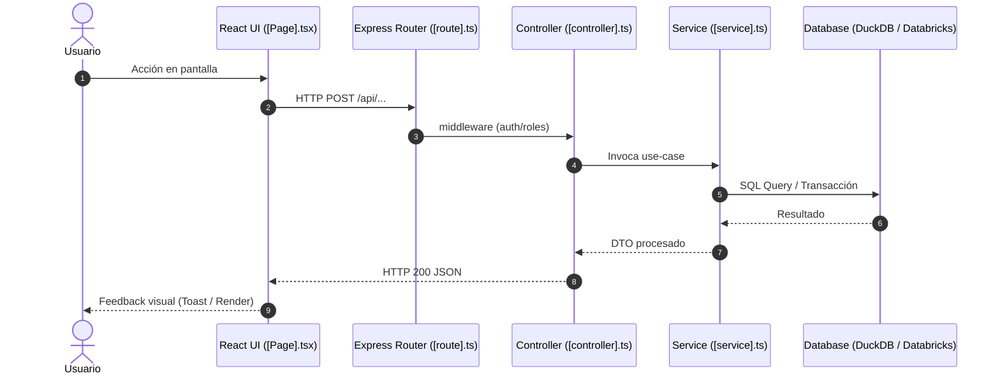

# Epiroc Documenter (Documentador Integral Logistech)

Esta skill define el estándar operativo y metodológico para auditar, trazar y documentar exhaustivamente cualquier funcionalidad o módulo en **Logistech**.

Genera dos vertientes de documentación en formato Markdown (`.md`):
1. **Documentación Técnica**: Para desarrolladores, arquitectos y soporte L3 (flujo en código, 3 capas REST, consultas y tablas de base de datos, validaciones cruzadas, fórmulas matemáticas y puntos de extensión).
2. **Manual de Usuario / Guía Funcional**: Para usuarios finales y operaciones (guía interactiva paso a paso: "Haga clic en...", "Seleccione...", "Se desplegará un modal que le permitirá...", sin tecnicismos de código, con prerequisitos de roles y explicación de estados).

---

## Principio Cardinal: Responsabilidad Compartida y Cero Ocultamiento (Zero-Bypass)

> [!CAUTION]
> **TODOS SOMOS RESPONSABLES DE LA CALIDAD Y ESTABILIDAD DE LOGISTECH**
> En Epiroc, la documentación no es un proceso pasivo ni cosmético: es una **auditoría profunda de la verdad del sistema**.
> Está **ESTRICTAMENTE PROHIBIDO** documentar alrededor de un error, obviar inconsistencias o asumir que una falla es normal. Si durante el recorrido del código o de la interfaz se detecta cualquier bug, discrepancia UI-Backend, validación faltante, cálculo erróneo o violación de las reglas de arquitectura de Logistech, **la skill DEBE DETENER SU EJECUCIÓN INMEDIATAMENTE (HALT)**, emitir el reporte estructurado de falla y delegar la resolución a `epiroc-debugging` y `epiroc-coding` antes de continuar.

---

## When to use this skill

- Documentar cómo funciona una funcionalidad de negocio en cualquiera de los módulos de Logistech (Tickets, DIFOT, Redistribuciones, Proyectos, Cotizaciones, Concesiones, Administración o en las nuevas que se vayan agregando).
- Crear **manuales de usuario** prácticos paso a paso para capacitación o autoservicio operativo.
- Elaborar **especificaciones técnicas de flujo** para desarrolladores que necesiten saber qué archivos modificar, qué funciones intervienen, qué fórmulas se calculan y qué tablas se consultan.
- Trazar el ciclo de vida completo de un dato desde el clic en React hasta el commit en la base de datos DuckDB / Databricks SQL.
- **Trigger keywords**: `documentar`, `documentador`, `manual de usuario`, `manual funcional`, `documentación técnica`, `guía de uso`, `trazar flujo`, `cómo funciona`, `explicar funcionalidad`, `recorrer flujo`, `paso a paso usuario`, `technical doc`, `user manual`.

---

## Dependencias & Coordinación en el Ecosistema

- **epiroc-debugging**: Se invoca **obligatoriamente** al activar el protocolo HALT cuando se encuentra un error o inconsistencia en el flujo.
- **epiroc-coding**: Define las normas de código, arquitectura de capas, enlaces de SQL y TypeScript estricto.
- **epiroc-api**: Para auditar la arquitectura REST (rutas, controladores, servicios y adaptador DB).
- **epiroc-workflows**: Para validar y documentar ciclos de vida de tickets, SLA y aprobaciones multinivel.
- **epiroc-roles-matrix** & **epiroc-security**: Para identificar exactamente qué roles (`ROLE_IDS`) y permisos (`role_pages`) tienen acceso al flujo.
- **epiroc-ux** & **epiroc-ui**: Para estandarizar la nomenclatura de componentes (`PageHeader`, `Modal`, `Stepper`), temas y estilos oficiales.
- **epiroc-qa**: Para correlacionar la documentación con casos de prueba y planes de verificación.
- **epiroc-doc-publisher**: Se activa tras generar el documento `.md` cuando el usuario requiera exportar el manual o la especificación técnica a formato ejecutivo **DOCX (Word)** o **PDF** con la identidad visual corporativa de Epiroc.

---

## 1. Paso Previo Obligatorio: Triage del Tipo de Documento (INTERVIEW GATE)

Antes de inspeccionar archivos o redactar cualquier contenido, la skill **DEBE** confirmar taxativamente con el usuario el tipo de documento requerido si este no fue declarado explícitamente en el prompt inicial.

Debe formular la siguiente pregunta o activar `ask_question`:

> **"Para documentar la funcionalidad de forma precisa, por favor indica qué tipo de documento necesitas:"**
> 1. **Documento Técnico (Para Desarrolladores / Soporte L3)**: Arquitectura, flujo de código, rutas, controladores, servicios, persistencia SQL, fórmulas matemáticas, validaciones y restricciones.
> 2. **Manual de Usuario / Documento Funcional (Para Usuarios Finales / Negocio)**: Guía práctica paso a paso en lenguaje natural ("Haga clic en...", "Seleccione..."), roles requeridos, comportamiento visual y preguntas frecuentes.
> 3. **Documento Integral / Híbrido (Ambos)**: Incluye ambas secciones claramente delimitadas para un gobierno 360° de la funcionalidad.

---

## 2. Metodología de Trazabilidad en 2 Fases

La revisión se ejecuta siempre en orden estricto: **Primero el Código, luego la UI**.

```
┌─────────────────────────────────────────────────────────────────────────────┐
│                       FASE 1: TRAZADO EN CÓDIGO                             │
│                                                                             │
│   Frontend (React)           API (Express)           Servicio & DB          │
│  ┌─────────────────┐       ┌─────────────────┐     ┌──────────────────┐    │
│  │ App.tsx/Page    │ ────► │ Route/Middleware│ ──► │ Service/Logic    │    │
│  │ Hooks & Fetch   │       │ Controller      │     │ DuckDB/Databricks│    │
│  └─────────────────┘       └─────────────────┘     └──────────────────┘    │
│            │                                                 │              │
│            ▼                                                 ▼              │
│  - Restricciones UI                                - Fórmulas matemáticas   │
│  - Parámetros enviados                             - Validaciones backend   │
│  - Manejo de estados                               - Transacciones & SQL    │
└─────────────────────────────────────────────────────────────────────────────┘
                                      │
                                      ▼
┌─────────────────────────────────────────────────────────────────────────────┐
│                         FASE 2: TRAZADO EN UI                               │
│                                                                             │
│  Navegación & Roles          Interacción Pantalla     Respuestas del Sistema│
│  ┌─────────────────┐       ┌─────────────────┐     ┌──────────────────┐    │
│  │ Workspace/Menú  │ ────► │ Formulario/Modal│ ──► │ Toasts / Mensajes│    │
│  │ Role IDs mínimos│       │ Botones & Clics │     │ Spinners / Listas│    │
│  └─────────────────┘       └─────────────────┘     └──────────────────┘    │
│            │                                                 │              │
│            ▼                                                 ▼              │
│  - Ruta de acceso                                  - "Haga clic en..."      │
│  - Visibilidad condicional                         - "Se desplegará..."     │
└─────────────────────────────────────────────────────────────────────────────┘
```

### Fase 1: Trazado en el Código (Code Flow Tracing)

El documentador debe leer los archivos reales usando `view_file` o `grep_search` sin inventar nombres ni inferir sin evidencia:

1. **Frontend Entry Point**:
   - Ruta en `client/src/App.tsx`, identificando el `pageId` y componente asociado.
   - Componente de página en `client/src/pages/` y componentes hijos (`client/src/components/`).
   - Hooks de estado (`useState`, `useReducer`), contextos (`UserSessionContext`, `WorkspaceNavigationContext`).
   - Llamadas a API (`fetch`, `apiService`), endpoints invocados, verbos HTTP y payloads enviados.
2. **Capa API & Middlewares**:
   - Definición del endpoint en `server/routes/`.
   - Middlewares aplicados: autenticación SSO (`x-forwarded-email`), control de roles (`requireRole`), permisos por página (`requirePageAccess`).
3. **Capa Controladores & Servicios de Dominio**:
   - Controlador en `server/controllers/`: extracción de parámetros, códigos de estado HTTP devueltos.
   - Servicio en `server/services/`: orquestación de negocio, flujos alternativos, manejo de excepciones.
4. **Persistencia & Capa de Datos**:
   - Tablas consultadas o modificadas en `schema.sql` y `schema_databricks.sql`.
   - Consultas SQL ejecutadas (verificando que usen parámetros enlazados `$1, $2`).
   - Integridad transaccional: ¿se ejecutan múltiples escrituras en una sola transacción o conexión compartida?
   - Datos maestros o catálogos en `init_values.sql` y `init_values_databricks.sql`.
5. **Algoritmos, Fórmulas y Validaciones**:
   - Fórmulas matemáticas explícitas (cálculo de SLA, conversiones a SEK, totales con impuestos, porcentajes de avance, scoring DIFOT, fórmulas de inventario).
   - Validaciones cruzadas (fechas inicio < fecha fin, montos positivos, campos obligatorios condicionales).

### Fase 2: Trazado en la Interfaz de Usuario (UI Flow Tracing)

El documentador traduce la lógica del sistema a la experiencia visible del usuario:

1. **Punto de Entrada y Navegación**:
   - Nombre del Workspace y selector de módulos (`/`).
   - Ubicación en el Sidebar y migas de pan (`PageHeader`).
   - Roles requeridos: qué roles (`ROLE_IDS`) pueden ver la opción en el menú según `role_pages`.
2. **Paso a Paso Interactivo de Usuario**:
   - Redacción imperativa, clara y libre de jerga técnica interna.
   - Sintaxis estandarizada:
     * *"1. Ingrese al módulo **[Nombre]** desde el menú principal."*
     * *"2. En la barra superior, haga clic en el botón **[Nombre del Botón]**."*
     * *"3. Se abrirá la ventana modal **[Título del Modal]**, donde deberá ingresar la siguiente información:..."*
     * *"4. En el campo **[Nombre del Campo]**, seleccione **[Opción]**..."*
     * *"5. Para finalizar, presione **[Guardar]**. El sistema mostrará un mensaje de confirmación verde y la tabla se actualizará automáticamente."*
3. **Estados Visuales y Reactividad**:
   - Indicadores de carga (spinners o skeletons) y comportamiento mientras se procesa.
   - Validaciones en pantalla (marcado de campos en rojo, textos de ayuda).
   - Ventanas modales de confirmación (recordar: ¡`alert()` y `confirm()` nativos están prohibidos!).
   - Mensajes Toast (color, icono y texto que ve el usuario).

---

## 3. Protocolo de Parada Obligatoria ante Errores (HALT Protocol)

> [!IMPORTANT]
> **REGLA BLOQUEANTE: AL ENCONTRAR UN ERROR O INCONSISTENCIA, LA EJECUCIÓN SE DETIENE.**
> No se permite entregar un documento que describa un comportamiento defectuoso sin antes haberlo reportado y detenido la marcha para su corrección.

### Triggers de Parada Obligatoria

Si durante el análisis en código o UI se detecta cualquiera de los siguientes problemas, el agente **DEBE DETENERSE**:

1. **Inconsistencia UI vs Backend**:
   - La UI envía campos que el backend ignora o descarta.
   - El backend exige campos obligatorios que la interfaz no solicita, causando error 400/500 al guardar.
   - Discrepancia en formatos (ej. formato de fecha ISO vs YYYY-MM-DD, enteros vs strings).
2. **Vulnerabilidad o Falla de Autorización**:
   - Comprobación de roles por nombre de texto (`role.name === 'admin'`) violando la Regla 6e (`ROLE_IDS`).
   - Validación presente solo en el frontend pero omitida en el backend (bypass de seguridad).
   - Acceso no protegido a un endpoint sensible.
3. **Violación de Reglas de Arquitectura Logistech**:
   - Llamadas SQL directas en controladores o rutas Express (Regla 6).
   - Uso de alertas nativas del navegador `alert()`, `confirm()`, `prompt()` en JSX (Regla 5).
   - Uso de estilos en línea `style={{ ... }}` en lugar de clases CSS estándar (Regla 5).
   - Transacciones simuladas con `query()` secuenciales sin transacción atómica en escrituras múltiples (Regla 6).
   - `console.log` huérfanos en archivos de producción (Regla 4).
   - Tablas en `schema.sql` sin espejo en `schema_databricks.sql` o no registradas en `server/services/dbResetService.ts` (Regla 6c).
4. **Errores de Lógica o Cálculo**:
   - Fórmulas con riesgo de división por cero, valores `NaN` o desbordamiento numérico.
   - Conversión de monedas sin fallback o con tasas fijas no extraídas de `conversion_rates`.
   - Máquina de estados rota (estados a los que nunca se puede llegar o de los que no se puede salir).
5. **UI Colgada o Bugs de Experiencia**:
   - Modales que quedan con botón "Cargando..." infinito si la petición falla en el `catch`.
   - Rutas o enlaces rotos (404).

### Plantilla de Reporte de Parada (HALT Report)

Al dispararse el HALT, el agente emite inmediatamente el siguiente bloque y detiene su turno para que actúe `epiroc-debugging`:

```markdown
🛑 [PARADA OBLIGATORIA POR ERROR / INCONSISTENCIA DETECTADA - epiroc-documenter]

Se ha detenido el proceso de documentación debido a una inconsistencia crítica en el flujo auditado.
Como todos somos responsables de la calidad de la aplicación, este error debe corregirse antes de continuar.

- 📁 Archivo: `[ruta del archivo]` (Líneas `[rango]`)
- 🔍 Tipo de Falla: [Inconsistencia UI-Backend | Bug de Lógica | Violación de Regla | Falla de Seguridad]
- 📝 Descripción: [Explicación detallada de lo que hace el código actualmente vs lo que debería hacer]
- 💥 Impacto: [Qué experimenta el usuario o qué riesgo corre la integridad de datos]
- 🛠️ Causa Raíz Técnica: [Análisis puntual de la causa]
- 📋 Sugerencia de Corrección: [Orientación para epiroc-debugging / epiroc-coding]

👉 ACCIÓN REQUERIDA: Activar la skill `epiroc-debugging` para resolver esta incidencia. Una vez verificada la corrección, reanudar la documentación.
```

---

## 4. Estructura Estándar de los Documentos de Salida (.md)

Todo documento generado por esta skill se entrega en formato Markdown limpio, guardado preferentemente en:
- `docs/technical/<modulo>-<funcionalidad>.md` para documentos técnicos.
- `docs/manuals/<modulo>-<funcionalidad>.md` para manuales de usuario.
- O en la ruta que el usuario indique explícitamente.

> [!NOTE]
> **Compatibilidad de Exportación (DOCX / PDF)**:
> Todo documento `.md` **debe iniciar obligatoriamente con el bloque de metadatos Frontmatter YAML** (`title`, `module`, `version`, `author`, `reviewer`, `date`, `history`). Esto permite que la skill compañera **`epiroc-doc-publisher`** lo convierta directamente a Word (`.docx`) o PDF corporativo con portada oficial y control de cambios sin pérdida de datos.

### Estructura A: Documento Técnico

```markdown
# Especificación Técnica: [Nombre de la Funcionalidad]

**Módulo**: [Nombre del Módulo / Workspace ID]  
**Fecha de Auditoría**: YYYY-MM-DD  
**Auditor**: epiroc-documenter  
**Estado del Código**: Verificado (0 errores / inconsistencias resueltas)

---

## 1. Resumen y Propósito Técnico
[Descripción técnica concisa del objetivo de la funcionalidad]

## 2. Mapa de Arquitectura y Componentes
- **Frontend Entry**: `client/src/pages/[Page].tsx` (Page ID: [ID])
- **Componentes UI**: `client/src/components/[Component].tsx`
- **Ruta API**: `server/routes/[route].ts` (`[MÉTODO] /api/[endpoint]`)
- **Controlador**: `server/controllers/[controller].ts` -> `[métodoControlador]`
- **Servicio de Dominio**: `server/services/[service].ts` -> `[funciónServicio]`
- **Tablas de Base de Datos**: `[tabla_1]`, `[tabla_2]` (`schema.sql` / `schema_databricks.sql`)

## 3. Diagrama de Secuencia / Flujo de Datos


## 4. Esquema de Datos y Persistencia
| Columna | Tipo | Nullable | Restricción / FK | Descripción |
|---|---|---|---|---|
| `id` | INTEGER / BIGINT | NO | PK IDENTITY | Identificador único |
| ... | ... | ... | ... | ... |

## 5. Matriz de Autorización y Seguridad
- **Workspace ID**: `[ID]`
- **Page ID**: `[ID]` (registrado en `role_pages`)
- **Roles Autorizados**: Utiliza constantes de `ROLE_IDS` (ej: `ADMIN: 1`, `TICKETS_ADMIN: 6`).
- **Middlewares aplicados**: `[requireRole / requirePageAccess / etc.]`

## 6. Fórmulas, Algoritmos y Reglas de Negocio
- **Fórmula de cálculo**:
  $$[Fórmula en formato legible o LaTeX/código]$$
- **Validaciones de Backend**:
  - `[Campo]`: Rango permitido, obligatoriedad, formato.
- **Transaccionalidad**:
  - `[Descripción del bloque de transacción única en caso de multi-write]`

## 7. Guía de Mantenibilidad y Búsqueda en Código
- ¿Dónde modificar las validaciones?: `[archivo.ts:línea]`
- ¿Dónde agregar un nuevo campo en BD?: `schema.sql`, `schema_databricks.sql`, `server/services/dbResetService.ts`
- ¿Dónde ajustar el cálculo o fórmula?: `server/services/[service].ts`
```

---

### Estructura B: Manual de Usuario / Documento Funcional

```markdown
# Manual de Usuario: [Nombre de la Funcionalidad]

**Módulo**: [Nombre del Módulo]  
**Perfil Destinatario**: [Usuarios Operativos / Aprobadores / Líderes de Contrato]  
**Versión**: 1.0  
**Fecha**: YYYY-MM-DD

---

## 1. ¿Qué es y para qué sirve?
[Explicación clara y sencilla, orientada al valor de negocio, sin jerga de código]

## 2. Requisitos Previos y Permisos
- **Módulo**: Debe tener habilitado el módulo **[Nombre]** en su pantalla de inicio.
- **Rol requerido**: Debe contar con perfil **[Nombre del Rol visible]**. Si no visualiza esta opción, solicite acceso al administrador.

## 3. ¿Cómo acceder? (Paso a Paso)
1. Inicie sesión en **Logistech**.
2. En la pantalla principal, seleccione el módulo **[Nombre del Módulo]**.
3. En el menú lateral izquierdo (Sidebar), haga clic en **[Categoría]** y luego en **[Submenú / Página]**.
4. Verá en pantalla la vista principal con el título **[Título de PageHeader]**.

## 4. Guía Operativa Paso a Paso

### 4.1. [Paso / Acción Principal, ej: Crear una nueva solicitud]
1. En la parte superior derecha de la pantalla, haga clic en el botón **[Nombre del Botón, ej: "+ Nuevo Registro"]**.
2. Se desplegará una ventana emergente titulada **[Título del Modal]**.
3. Complete la información solicitada:
   - **[Nombre del Campo 1]** *(Obligatorio)*: Seleccione la opción correspondiente de la lista desplegable.
   - **[Nombre del Campo 2]** *(Obligatorio)*: Ingrese el valor numérico.
   - **[Comentarios]** *(Opcional)*: Escriba observaciones adicionales para el aprobador.
4. Revise que los datos sean correctos y haga clic en **[Confirmar / Guardar]**.
5. El sistema procesará la solicitud y mostrará una notificación verde en la esquina superior con el mensaje: *"Operación realizada con éxito"*.
6. El nuevo registro aparecerá listado inmediatamente en la tabla.

## 5. Glosario de Estados y Acciones
| Estado / Icono | Significado | ¿Qué acción debe realizar el usuario? |
|---|---|---|
| 🟡 **Pendiente** | La solicitud fue creada y espera revisión. | Aguardar la aprobación del líder. |
| 🟢 **Aprobado** | La solicitud fue validada favorablemente. | Continuar con la fase de despacho/ejecución. |
| 🔴 **Rechazado** | La solicitud fue denegada. | Revisar los comentarios del rechazo para corregir y reenviar. |

## 6. Mensajes Frecuentes y Solución de Problemas
- ❓ **"El botón de guardar está deshabilitado"**:
  - *Causa*: Falta completar algún campo obligatorio marcado con asterisco (*).
  - *Solución*: Revise que todos los campos requeridos contengan información válida.
- ❓ **"No puedo ver el registro en la lista"**:
  - *Causa*: Filtros de búsqueda activos.
  - *Solución*: Limpie los filtros de fecha o entidad en la barra superior.
```

---

## 5. Checklist de Meticulosidad (Quality Audit Gate)

Antes de considerar finalizada la entrega del documento `.md`, el documentador debe validar:

- [ ] **Triage inicial verificado**: Se consultó o confirmó explícitamente el tipo de documento (técnico / funcional / híbrido).
- [ ] **Trazabilidad dual completada**: Se inspeccionó primero el código fuente real y luego el recorrido en UI.
- [ ] **Cero errores tolerados (Anti-Ocultamiento)**: Si se halló cualquier inconsistencia, se ejecutó el protocolo HALT y se coordinó con `epiroc-debugging`.
- [ ] **Sin inventar código ni rutas**: Todos los archivos citados existen y sus rutas son enlaces markdown clicables válidos (`[archivo.ts](file:///...)`).
- [ ] **Roles por ID**: En la sección técnica se usaron `ROLE_IDS` (Regla 6e) y en la funcional los nombres amigables de UI.
- [ ] **Fórmulas matemáticas explicitadas**: Si hay cálculos de moneda, SLA o stock, se detallaron paso a paso con sus fuentes de datos.
- [ ] **Componentes Epiroc respetados**: Se documentaron los componentes reales (`PageHeader`, `Modal`, `Stepper`, etc.) sin asumir diálogos nativos.
- [ ] **Formato Markdown limpio**: Sin bloques truncados, con Mermaid renderizable y tablas bien tabuladas.
- [ ] **Higiene de archivos temporales**: No dejar scripts o borradores huérfanos sin prefijo `eliminar_` (Regla 4).
