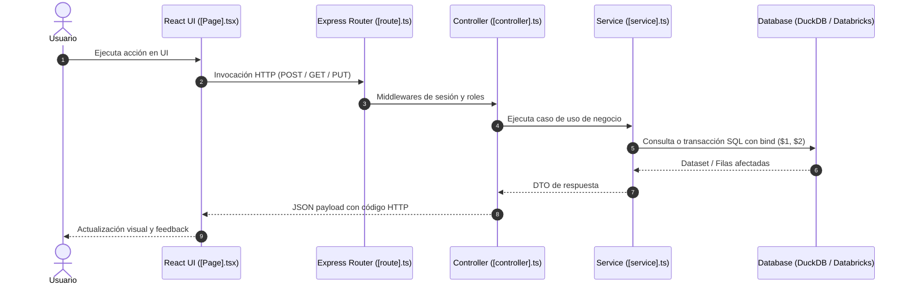

# Especificación Técnica: [Nombre de la Funcionalidad / Proceso]

**Módulo**: [Nombre del Módulo] (Workspace ID: [ID])  
**Fecha de Elaboración**: YYYY-MM-DD  
**Auditor / Autor**: epiroc-documenter  
**Estado de Verificación**: [Auditado / Sin errores detectados / Inconsistencias resueltas]  

---

## 1. Alcance y Arquitectura General

### 1.1. Propósito Técnico
[Explicación concisa del problema de ingeniería que resuelve y su rol dentro de la arquitectura de Logistech]

### 1.2. Mapeo de Capas de Código
| Capa | Archivo / Componente | Responsabilidad |
|---|---|---|
| **Ruta Frontend** | `client/src/App.tsx` | Declaración de ruta `/...` con `pageId = ...` |
| **Vista / Página** | `client/src/pages/[Page].tsx` | Contenedor principal de React, estados de vista |
| **Componentes UI** | `client/src/components/[Component].tsx` | Modales, formularios, tablas (`PageHeader`, `Modal`) |
| **Ruta Backend** | `server/routes/[route].ts` | Enrutamiento Express, middlewares de auth y roles |
| **Controlador** | `server/controllers/[controller].ts` | Traducción HTTP, códigos de estado, validación DTO |
| **Servicio de Negocio** | `server/services/[service].ts` | Lógica de dominio, reglas, transacciones |
| **Persistencia / BD** | `schema.sql` / `schema_databricks.sql` | Tablas DDL, llaves foráneas, índices |
| **Master Data** | `init_values.sql` / `init_values_databricks.sql` | Datos semilla y catálogos estáticos |

---

## 2. Diagrama de Flujo y Secuencia



---

## 3. Modelo de Persistencia y Estructura SQL

### 3.1. Tablas Afectadas
- `[nombre_tabla_principal]`
- `[nombre_tabla_detalle]`

### 3.2. Diccionario de Datos
| Columna | Tipo DuckDB | Tipo Databricks | Nulo | Default | Restricción / FK | Descripción |
|---|---|---|---|---|---|---|
| `id` | INTEGER | BIGINT | NO | IDENTITY | PK | Identificador numérico |
| `workspace_id` | INTEGER | BIGINT | NO | - | FK -> `workspaces(id)` | Módulo al que pertenece |
| ... | ... | ... | ... | ... | ... | ... |

---

## 4. Matriz de Seguridad y Autorización

- **Workspace ID**: `[ID]`
- **Page ID**: `[ID]` (registrado en `pages` y `role_pages`)
- **Roles Autorizados (`ROLE_IDS`)**:
  - `ROLE_IDS.GLOBAL_ADMIN` (1)
  - `ROLE_IDS.[MODULO]_ADMIN` ([ID])
  - `ROLE_IDS.[MODULO]_OPERATOR` ([ID])
- **Validaciones de Seguridad en Backend**:
  - Headers SSO evaluados: `x-forwarded-email` -> `x-forwarded-preferred-username` -> `x-user-email`.
  - Integridad de usuario: siempre referenciado por `users.id` (INTEGER) y nunca por email en relaciones de BD.

---

## 5. Reglas de Negocio, Validaciones y Algoritmos

### 5.1. Fórmulas Matemáticas y Cálculos
- **Fórmula**:
  ```text
  [Escribir la fórmula exacta utilizada en el código, especificando variables y origen de datos]
  ```
- **Moneda y Conversión**: [Si aplica, detallar cómo se consulta `conversion_rates` y si se convierte a SEK].

### 5.2. Validaciones Cruzadas (Frontend vs Backend)
| Regla / Validación | Validación Frontend | Validación Backend | Código de Error |
|---|---|---|---|
| Rango de fechas | Inicio <= Fin en selector | Verificación en servicio | 400 Bad Request |
| Montos positivos | `min="0"` en input | `amount > 0` en servicio | 422 Unprocessable |
| Transición de estado | Botón condicional | Máquina de estados en BD | 403 Forbidden |

### 5.3. Transaccionalidad (Multi-Write)
- [Detallar el uso de transacciones con el adaptador DB para garantizar que todas las escrituras se completen o hagan rollback atómico].

---

## 6. Guía de Mantenimiento y Extensiones

- **¿Dónde agregar un nuevo campo?**:
  1. `schema.sql` (DuckDB) y `schema_databricks.sql` (Databricks)
  2. `server/services/dbResetService.ts` (mantener sincronizado)
  3. `server/services/[service].ts` (mapeo del DTO)
  4. `client/src/pages/[Page].tsx` (renderizado en formulario)
- **¿Dónde modificar las restricciones de rol?**:
  - `server/routes/[route].ts` (middlewares `requireRole`)
  - `client/src/components/UserSessionContext.tsx` (`ROLE_IDS`)
