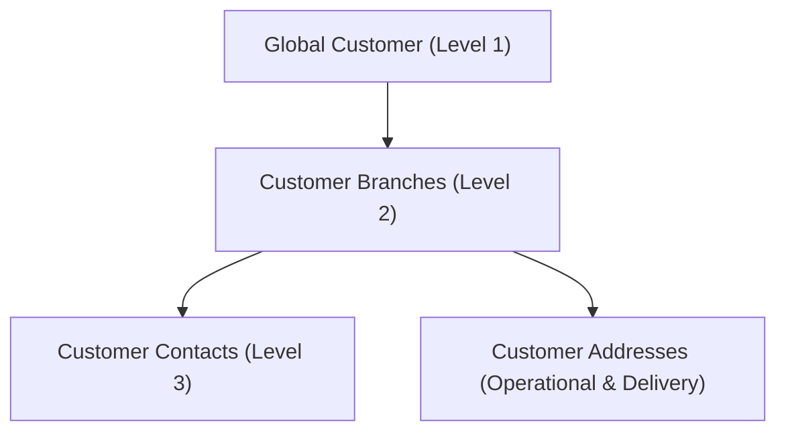

# Customer Management User Guide

## 1. Overview
The **Customer Master Data Management** module is a central administration tool designed to manage Epiroc's customer records in a structured, hierarchical manner. It allows administrators to maintain customer identities, physical branches across different legal entities, and authorized contact persons, adhering to strict data validation and brand compliance guidelines.

---

## 2. Hierarchical Data Model

The customer directory is organized into a three-level hierarchy to ensure data integrity and flexibility:

### 2.1. Global Customer (Level 1)
* Represents the client company at a global level (e.g., BHP Billiton, Codelco).
* Controls the global active status of the customer. If a global customer is marked as **Inactive**, none of its branches or contacts will be selectable during ticket creation or approval flows.

### 2.2. Customer Branch (Level 2)
* Represents a physical branch or subsidiary associated with a specific legal entity (e.g., BHP under entity `CLN` as Minera Los Pelambres SpA).
* A single global customer can have multiple branches under the same legal entity (e.g., BHP with one branch in Pelambres and another in Copiapó under the entity `CLE`).
* **Branch Code Uniqueness:** Every branch must have a globally unique `branch_code` (e.g., `SUC-BHP-001`). The system rejects duplicates at the database level to maintain consistency.

### 2.3. Customer Contact (Level 3)
* Represents the contact persons representing the customer at a specific branch.
* Stores details such as **Full Name**, **Email**, and **Phone**.
* **Primary Contact:** Each branch can have multiple contacts, but only one can be designated as the **Primary Contact** (e.g. for automatic notification routing).

---

## 3. Physical Addresses

Each branch supports two distinct types of addresses stored in the `customer_addresses` master data table:

1. **Operational/Administrative Address:** The main administrative office address for billing or management.
2. **Delivery Address:** The physical location where goods or field services are actually delivered.

### 3.1. Address Synchronization Flow
To simplify administration, the branch creation/edition form includes a checkbox:
* **"Usar la misma dirección para despacho" (Use the same address for delivery):**
  * When checked, the system automatically copies the administrative address values (Street, City, Country, and Postal Code) to the delivery address fields upon saving.
  * When unchecked, a secondary grid of inputs is displayed, allowing administrators to configure a different delivery address (e.g., for mine site deliveries).

---

## 4. Administration Interface

The administration UI is located under the central configuration submenu:
**Configuración ➔ Master data ➔ Clientes**

### 4.1. Global Customers Panel
* **Search:** Filter the list of global customers in real-time by ID.
* **Status Badge:** Visual representation of active/inactive customers.
* **Manage Button:** Opens the double-tabbed management modal.

### 4.2. Management Modal (Size: XL)
The management modal is sized `xl` to comfortably present complex structures. It contains two tabs:

#### Tab A: Datos Generales (General Data)
* Displays metadata (Creation date, Last update time).
* Allows switching the global active status of the customer.

#### Tab B: Sucursales por Entidad (Branches by Entity)
* Lists all branches linked to the customer.
* **Branch Form:** Collapsible form to add or edit branches, featuring:
  * Dropdowns for **Legal Entity** and **Country** populated from master tables.
  * Branch Code and Legal Name inputs.
  * Collapsible Address synchronization layouts.
* **Contacts Sub-panel:** Clicking on a branch expands its contact directory:
  * Add, edit, or delete contact persons.
  * Toggle "Primary Contact" designation.
  * Breadcrumb navigation to return to the branches list.

---

## 5. Validation and Safety Rules

The module enforces several validations to ensure data health:

* **Uniqueness Constraints:**
  * **Branch Code:** Attempting to save a duplicate `branch_code` triggers a database constraint error, which is caught and shown as: `"El código de sucursal ya existe en el sistema. Debe ser único globalmente."`
  * **Customer Branch per Entity:** Releasing the old entity-lock constraint allows multiple branches per customer-entity pair as long as the branch codes differ.
* **Epiroc Brand Compliance:** No native dialogs (`alert`, `confirm`) are used. Confirmations and error reports utilize frosted-glass modal overlay dialogs conforming to WCAG 2.1 AA contrast levels.
* **SSO Identity Fallback:** In development mode, user actions fallback to standard system administrator emails, but strictly use bound SQL parameterized parameters (`$1`, `$2`) referencing numeric IDs from the `users` table rather than raw email strings.
