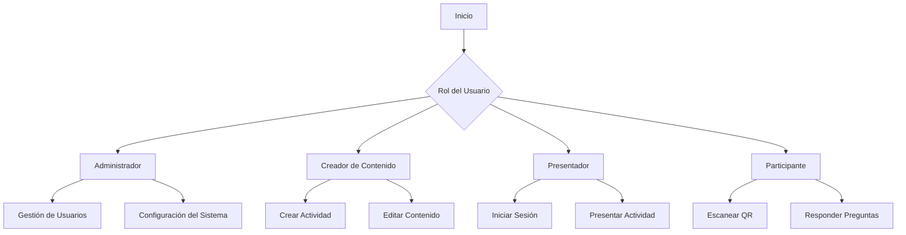

# Documento de Solicitud de Requerimientos

## Plataforma de Gamificación y Presentaciones Interactivas para Empresas

**Nombre del proyecto:** [Nombre de la Herramienta]
**Versión del documento:** 1.0
**Fecha:** 15 de octubre de 2026
**Elaborado para:** [Nombre de la Empresa]
**Elaborado por:** Equipo de Análisis de Requerimientos
**Aprobado por:** [Pendiente de asignación]
**Referencia:** Funcionalidades inspiradas en Kahoot! y Mentimeter

---

## 1. Resumen Ejecutivo

El presente documento define los requerimientos funcionales y no funcionales para el desarrollo de una plataforma empresarial que combine las mecánicas de gamificación de Kahoot! (cuestionarios competitivos, puntuaciones, rankings en tiempo real) con las capacidades de presentación interactiva de Mentimeter (encuestas en vivo, nubes de palabras, visualización de datos). La herramienta permitirá a los presentadores crear experiencias interactivas donde la audiencia participe desde sus dispositivos móviles escaneando un código QR, con los resultados visualizándose en tiempo real en la pantalla principal. La plataforma será web, responsive, accesible desde cualquier dispositivo y estará completamente personalizada con la identidad visual de [Nombre de la Empresa] (colores corporativos, logotipo, tipografías y fondos), siendo la personalización de marca una característica central del sistema.

---

## 2. Objetivos del Producto

| Objetivo | Descripción |
|----------|-------------|
| **Incrementar la participación** | Transformar presentaciones unidireccionales en experiencias bidireccionales donde la audiencia contribuya activamente. |
| **Gamificar la formación interna** | Aplicar mecánicas de juego (puntos, niveles, rankings, recompensas) a capacitaciones, reuniones, eventos corporativos y evaluaciones. |
| **Recolectar datos en tiempo real** | Capturar opiniones, conocimientos y feedback de la audiencia de forma instantánea para la toma de decisiones. |
| **Fortalecer la marca interna** | Asegurar que cada interacción esté alineada con la identidad visual corporativa de [Nombre de la Empresa]. |
| **Facilitar el acceso** | Eliminar barreras de entrada mediante acceso por código QR o código alfanumérico, sin necesidad de instalar aplicaciones ni crear cuentas. |
| **Visualización dinámica de datos** | Ofrecer múltiples formatos de gráficos que se actualicen en tiempo real conforme llegan las respuestas. |

---

## 3. Descripción General del Sistema

### 3.1 Propósito
Desarrollar una herramienta web que permita:
- **Gamificación** de actividades de capacitación, presentaciones y eventos corporativos.
- **Interacción en tiempo real** con la audiencia a través de dispositivos móviles.
- **Visualización dinámica** de respuestas y datos en pantalla principal.
- **Personalización total** de la interfaz con colores, marca y identidad de la empresa.

### 3.2 Alcance
- Plataforma web responsive accesible desde cualquier dispositivo.
- Sistema de participación vía código QR, código alfanumérico o enlace.
- Modo presentador/pantalla principal + modo participante/dispositivo móvil.
- Biblioteca de plantillas, banco de preguntas y componentes personalizables.

---

## 4. Alcance Funcional

La herramienta se organiza en los siguientes módulos funcionales:

1. **Módulo de Gestión de Sesiones y Acceso**
2. **Módulo de Tipos de Preguntas, Actividades y Mecánicas de Juego**
3. **Módulo de Visualización de Resultados en Vivo**
4. **Módulo de Presentación y Pantalla Principal**
5. **Módulo de Personalización y Marca Corporativa**
6. **Módulo de Análisis de Datos y Reportes**
7. **Módulo de Administración, Roles y Biblioteca de Contenidos**
8. **Módulo de Integración y Compatibilidad**

---

## 5. Requerimientos Funcionales Detallados

### Módulo 1: Gestión de Sesiones y Acceso

#### RF-01: Creación de sesiones de presentación
El sistema deberá permitir al presentador crear una nueva sesión de presentación interactiva desde un panel de control web. Cada sesión tendrá un nombre, fecha de creación y estado (borrador, activa, finalizada).

#### RF-02: Generación automática de código de acceso
Al iniciar una sesión, el sistema generará automáticamente un **código QR único** y un **código alfanumérico de 6 dígitos** para que los participantes se unan. El código deberá mostrarse prominentemente en la pantalla de presentación.

#### RF-03: Acceso sin instalación de aplicaciones
Los participantes deberán poder unirse a la sesión escaneando el código QR con la cámara de su dispositivo, ingresando el código alfanumérico o mediante un enlace, desde cualquier navegador móvil, sin necesidad de descargar una aplicación ni crear una cuenta.

#### RF-04: Tipos de sesión
El sistema deberá soportar tres modalidades de sesión:
- **Sesión en vivo (Live):** El presentador controla el ritmo y los participantes responden en tiempo real.
- **Sesión autoguiada (Self-paced):** Los participantes avanzan a su propio ritmo dentro de una ventana de tiempo definida.
- **Sesión híbrida:** Combinación de preguntas en vivo y contenido de consulta asíncrona.

#### RF-05: Control de participación y configuración de sesión
El presentador deberá poder configurar:
- Número máximo de participantes por sesión.
- Modo anónimo o identificación de participantes (nombre, correo, departamento).
- Límite de respuestas por participante.
- Autenticación requerida u opcional.
- Persistencia de los datos de la sesión.

#### RF-06: Sala de espera (Lobby)
Al unirse, los participantes serán dirigidos a una sala de espera que mostrará:
- El nombre de la sesión.
- El logotipo de la empresa.
- Instrucciones básicas.
- Un indicador de participantes conectados en tiempo real.

#### RF-07: Moderación de contenido
El sistema deberá ofrecer mecanismos de moderación configurables por el presentador:
- Filtro de palabras prohibidas/lenguaje ofensivo.
- Aprobación previa de respuestas antes de su publicación.
- Eliminación de respuestas inapropiadas.

---

### Módulo 2: Tipos de Preguntas, Actividades y Mecánicas de Juego

#### RF-08: Tipos de preguntas interactivas
El sistema deberá soportar los siguientes tipos de preguntas:

| Tipo de Pregunta | Descripción | Uso principal |
|------------------|-------------|---------------|
| **Opción Múltiple** | Selección única o múltiple entre opciones predefinidas. Permite marcar respuesta correcta para modo quiz. | Conocimiento, encuestas, votaciones. |
| **Verdadero/Falso** | Dos opciones excluyentes. Ideal para verificaciones rápidas. | Capacitación, evaluación rápida. |
| **Nube de Palabras** | Participantes envían palabras o frases cortas; las más frecuentes aparecen más grandes. | Lluvia de ideas, percepción de marca. |
| **Respuesta Abierta** | Texto libre sin límite estricto de caracteres (sujeto a filtro de moderación). | Feedback cualitativo, sugerencias. |
| **Escala (Likert)** | Escala numérica (ej. 1-5) para medir satisfacción, acuerdo o preferencia. | NPS, clima laboral, evaluaciones. |
| **Ranking** | Ordenar una lista de opciones por preferencia o prioridad. | Priorización de iniciativas, preferencias. |
| **Adivina el Número** | Los participantes estiman un valor numérico; se muestra el más cercano. | Dinámicas de estimación, juegos. |
| **100 Puntos** | Distribuir 100 puntos entre varias opciones. | Asignación de presupuesto, priorización ponderada. |
| **Puzzle/Ordenar** | Los participantes ordenan elementos en una secuencia correcta. | Procesos, cronologías, pasos. |
| **Q&A en Vivo** | Los participantes envían preguntas y votan por las más relevantes. | Sesiones de preguntas, town halls. |
| **Adivina la Imagen** | Imágenes que se revelan progresivamente junto con una pregunta. | Dinámicas de reconocimiento, juegos. |

#### RF-09: Tipos de actividades gamificadas
El sistema deberá soportar los siguientes formatos de actividad:

| Tipo de Actividad | Descripción |
|-------------------|-------------|
| **Quiz Competitivo** | Preguntas con opciones múltiples, tiempo limitado y puntuación. |
| **Trivia de Conocimiento** | Preguntas de respuesta abierta o selección múltiple en formatos variados. |
| **Adivina la Imagen** | Imágenes reveladas progresivamente con preguntas asociadas. |
| **Desafío por Equipos** | Competencia tipo torneo entre grupos o departamentos. |
| **Cuestionario Educativo** | Evaluaciones formativas con feedback inmediato (modo estudio). |

#### RF-10: Configuración de preguntas tipo quiz
Para las preguntas de opción múltiple y verdadero/falso, el presentador deberá poder:
- Marcar una o más respuestas como correctas.
- Asignar puntos base por respuesta correcta (ej. 0, 1000 o 2000 puntos, configurable).
- Configurar tiempo límite por pregunta (5–120 segundos).
- Activar/desactivar la visualización de la respuesta correcta.
- Activar opcionalmente bonus por rapidez de respuesta.
- Activar opcionalmente puntos negativos por respuestas incorrectas.
- Definir modo de desempate.

#### RF-11: Mecánicas de gamificación
El sistema deberá incluir:
- **Sistema de puntos:** Acumulación por respuestas correctas, velocidad de respuesta y multiplicadores por racha de aciertos.
- **Ranking en vivo:** Tabla de posiciones actualizada en tiempo real tras cada pregunta.
- **Rachas (streaks):** Bonificación por respuestas correctas consecutivas.
- **Tabla de líderes histórica:** Registro de mejores puntuaciones entre sesiones.
- **Podio final:** Pantalla de cierre con los tres primeros lugares.
- **Modo equipos:** Agrupación de participantes en equipos con puntuación colectiva, incluyendo competencias y torneos entre departamentos o áreas.

#### RF-12: Niveles y progresión
El sistema deberá ofrecer elementos de progresión:
- Barra de progreso visual.
- Niveles por puntuación alcanzada.
- Logros y badges desbloqueables.

---

### Módulo 3: Visualización de Resultados en Vivo

#### RF-13: Gráficos disponibles para visualización en pantalla
El sistema deberá ofrecer múltiples formatos de visualización para los resultados en tiempo real, seleccionables por el presentador:

| Tipo de Gráfico | Tipo de Pregunta Asociada | Descripción |
|-----------------|---------------------------|-------------|
| **Gráfico de Barras** | Opción Múltiple, Likert, Ranking | Barras horizontales o verticales que crecen en longitud conforme llegan los votos. El formato más versátil. |
| **Gráfico de Donut / Anillo** | Opción Múltiple, Verdadero/Falso | Gráfico circular con agujero central, ideal para proporciones relativas (2–6 opciones). |
| **Gráfico de Torta / Pie** | Opción Múltiple | Similar al donut pero sin agujero central. Útil para distribuciones porcentuales simples. |
| **Gráfico de Puntos** | Opción Múltiple | Cada voto se representa como un punto que se acumula en la opción correspondiente. |
| **Nube de Palabras** | Nube de Palabras | Las palabras más frecuentes aparecen con mayor tamaño y en el centro de la nube. |
| **Gráfico de Radar / Araña** | Escala (Likert), Opción Múltiple con múltiples criterios | Gráfico radial que compara múltiples atributos simultáneamente. Ideal para evaluaciones de habilidades o perfiles multi-criterio. |
| **Escala de Intensidad** | Likert | Barra horizontal con marcador que muestra el promedio de las respuestas y la distribución detrás del valor promedio. |
| **Tabla de Ranking** | Ranking | Lista ordenada de opciones según la puntuación acumulada, actualizada en tiempo real. |
| **Medidor de NPS** | Likert (0-10) | Visualización tipo gauge que muestra el Net Promoter Score calculado. |
| **Histograma** | Adivina el Número | Distribución de frecuencias de las estimaciones numéricas. |
| **Barra Apilada** | Opción Múltiple con categorías | Distribución de respuestas por segmento o grupo. |
| **Gráfico de Líneas** | Series de respuestas en el tiempo | Tendencias a lo largo del tiempo, con soporte para múltiples series (ej. encuestas pre/post). |
| **Gráfico de Dispersión (Scatter)** | Variables numéricas | Relación entre variables para análisis de correlación. |
| **Mapa de Calor** | Datos por región/categoría | Intensidad por región o categoría, útil para distribución geográfica. |
| **Timeline / Línea de Tiempo** | Eventos ordenados | Eventos ordenados temporalmente para procesos o secuencias históricas. |

#### RF-14: Visualización en tiempo real
Los gráficos deberán actualizarse automáticamente conforme llegan las respuestas, sin necesidad de que el presentador refresque la pantalla. El sistema deberá mostrar:
- Número total de respuestas recibidas.
- Porcentaje o conteo por cada opción.
- Indicador de votos pendientes (participantes que aún no responden).

#### RF-15: Control de visualización por el presentador
El presentador deberá poder:
- Alternar entre diferentes tipos de gráfico para la misma pregunta sin perder los datos.
- Ocultar o mostrar las respuestas durante la votación (evitar sesgo de arrastre).
- Bloquear la votación cuando lo considere oportuno.
- Mostrar la respuesta correcta después de cerrar la pregunta (modo quiz).

#### RF-16: Animaciones y transiciones
El sistema deberá ofrecer visualización dinámica con:
- Transiciones configurables entre elementos.
- Efectos de entrada/salida de datos.
- Animaciones de actualización en tiempo real.

#### RF-17: Pantalla de resultados finales
Al finalizar la sesión, el sistema deberá mostrar una pantalla resumen con:
- Podio de ganadores (en sesiones gamificadas).
- Resumen de todas las preguntas y sus resultados.
- Opción de exportar el resumen como PDF o imagen.

---

### Módulo 4: Presentación y Pantalla Principal

#### RF-18: Modo presentación a pantalla completa
El sistema deberá ofrecer un modo de presentación que ocupe toda la pantalla del dispositivo del presentador, mostrando:
- La pregunta actual.
- El código QR y el código de acceso.
- El gráfico de resultados en tiempo real.
- El temporizador (si aplica).
- El indicador de respuestas recibidas.

#### RF-19: Vista y controles del presentador
La vista del presentador deberá incluir:
- Controles de navegación entre preguntas.
- Vista previa de la próxima pregunta.
- Temporizador configurable por pregunta.
- Notas del presentador.
- Controles de juego: pausar, saltar y repetir preguntas.

#### RF-20: Control remoto del presentador
El presentador deberá poder controlar la sesión (avanzar preguntas, cerrar votaciones, mostrar resultados) desde su dispositivo móvil, liberándolo del ordenador.

---

### Módulo 5: Personalización y Marca Corporativa

#### RF-21: Temas personalizados con colores corporativos
El sistema deberá permitir crear temas visuales mediante un sistema de temas configurable, utilizando exclusivamente los colores corporativos de [Nombre de la Empresa]. El presentador podrá definir:
- Color primario (fondo principal).
- Color secundario (acentos, botones, barras).
- Color de texto.
- Color de fondo general y de fondo de gráficos.
- Estilos de botones y elementos de la interfaz de usuario.

#### RF-22: Logotipo corporativo y marcas de agua
El sistema deberá permitir subir el logotipo de la empresa (formatos JPG o PNG, relación de aspecto recomendada 2:1), con posición configurable, para que aparezca en:
- La pantalla de presentación (esquina superior).
- La pantalla de los dispositivos de los participantes.
- La pantalla de cierre o éxito.

Adicionalmente, deberá soportar el uso de marcas de agua y fondos de pantalla personalizados.

#### RF-23: Fuentes tipográficas corporativas
El sistema deberá ofrecer un conjunto de fuentes que incluyan las tipografías oficiales de [Nombre de la Empresa] (distinguiendo fuentes para títulos y cuerpo de texto), o en su defecto, permitir la carga de fuentes personalizadas.

#### RF-24: Plantillas de presentación con marca
El sistema deberá proporcionar plantillas de diapositivas preconfiguradas con la identidad visual de la empresa, para que los presentadores no tengan que configurar los colores manualmente en cada ocasión.

#### RF-25: Aplicación automática de colores desde el logotipo
El sistema deberá ofrecer la opción de extraer automáticamente los colores predominantes del logotipo corporativo y aplicarlos como tema predeterminado de la presentación.

#### RF-26: Consistencia multiplataforma
La identidad visual deberá mantenerse consistente tanto en la pantalla grande de presentación como en los dispositivos móviles de los participantes.

---

### Módulo 6: Análisis de Datos y Reportes

#### RF-27: Panel de resultados post-sesión
Al finalizar una sesión, el presentador deberá acceder a un panel donde podrá visualizar:
- Todas las preguntas realizadas.
- Los resultados agregados de cada pregunta.
- El tiempo promedio de respuesta por pregunta.
- La tasa de participación (porcentaje de participantes que respondieron).

#### RF-28: Exportación de datos
El sistema deberá permitir exportar los resultados en los siguientes formatos:
- **Excel (.xlsx):** Datos crudos por participante y por pregunta.
- **PDF:** Reporte visual con gráficos y resumen ejecutivo.
- **CSV:** Para integración con otras herramientas de análisis.
- **JSON:** Para consumo por sistemas externos.
- **Imagen:** Exportación de pantallas de resumen.

Adicionalmente, deberá soportar el envío automático de datos a sistemas de análisis corporativos.

#### RF-29: Segmentación de resultados
El sistema deberá permitir filtrar y segmentar los resultados por:
- Departamento o área de la empresa.
- Equipo.
- Rango de puntuación.
- Respuesta a preguntas anteriores (para análisis cruzado).

#### RF-30: Seguimiento de participación individual
En sesiones con identificación de participantes, el sistema deberá registrar:
- Preguntas respondidas por cada participante.
- Puntuación obtenida.
- Tiempo de respuesta.
- Respuestas correctas e incorrectas.

#### RF-31: Historial de sesiones
El sistema deberá mantener un historial de todas las sesiones realizadas, con posibilidad de:
- Buscar por nombre, fecha o presentador.
- Duplicar una sesión anterior para reutilizarla.
- Comparar resultados entre sesiones.

---

### Módulo 7: Administración, Roles y Biblioteca de Contenidos

#### RF-32: Gestión de usuarios y roles
El sistema deberá soportar los siguientes roles con permisos diferenciados:

| Rol | Permisos | Descripción |
|------|----------|-------------|
| **Administrador** | Todos los permisos | Gestiona toda la plataforma, usuarios y configuración del sistema. |
| **Creador de Contenido** | Crear/editar actividades | Diseña cuestionarios, presentaciones y contenidos. |
| **Presentador** | Ejecutar actividades | Conduce sesiones en vivo. |
| **Participante** | Responder actividades | Audiencia que interactúa. |

#### RF-33: Biblioteca de plantillas
El sistema deberá ofrecer una biblioteca de contenidos con:
- Más de 20 plantillas de actividades prediseñadas.
- Categorías: capacitación, encuestas, icebreakers, team building, evaluaciones y eventos.
- Plantillas personalizables.

#### RF-34: Banco de preguntas
El sistema deberá ofrecer:
- Un banco de preguntas reutilizable.
- Categorización por temas y dificultad.
- Importación de preguntas desde archivos CSV, Excel o JSON.
- Exportación en formatos estándar (CSV, JSON).
- Opción de duplicar y editar preguntas existentes.

---

### Módulo 8: Integración y Compatibilidad

#### RF-35: Integración con herramientas de videoconferencia
El sistema deberá ser compatible con las principales plataformas de videoconferencia corporativas (Zoom, Microsoft Teams, Google Meet) para:
- Compartir la pantalla de presentación.
- Permitir que los participantes remotos se unan vía QR o código.

#### RF-36: Integración con PowerPoint y Google Slides
El sistema deberá permitir insertar diapositivas interactivas dentro de presentaciones existentes en PowerPoint o Google Slides, sin necesidad de cambiar de herramienta.

#### RF-37: API para integración con sistemas corporativos
El sistema deberá exponer una API REST que permita:
- Crear sesiones programáticamente.
- Obtener resultados en formato JSON.
- Gestionar contenido mediante endpoints.
- Integrar con sistemas de RRHH, LMS o CRM de la empresa.

#### RF-38: Webhooks
El sistema deberá ofrecer webhooks para notificación de eventos en tiempo real hacia sistemas corporativos.

#### RF-39: Autenticación corporativa (SSO)
El sistema deberá integrarse con los sistemas de identidad corporativa mediante SSO con soporte para OAuth2/SAML.

#### RF-40: Compatibilidad de dispositivos
El sistema deberá funcionar en:

| Dispositivo | Navegadores Soportados | Funcionalidad |
|-------------|-------------------------|---------------|
| **Smartphones** | Chrome, Safari, Firefox | Participación completa |
| **Tablets** | Chrome, Safari, Edge | Participación y creación |
| **PC/Mac** | Chrome, Firefox, Edge, Safari | Funcionalidad completa |
| **Smart TVs** | Apps nativas / navegadores web | Presentación principal |

---

## 6. Requerimientos No Funcionales

| Categoría | Requerimiento |
|-----------|---------------|
| **Rendimiento** | Soportar un mínimo de 500 participantes simultáneos por sesión, con escalabilidad hasta 2,000 participantes (ampliable a 5,000+ según licenciamiento). Latencia inferior a 500 ms en interacciones básicas y sincronización de resultados en tiempo real en menos de 1 segundo. |
| **Disponibilidad** | Disponibilidad mínima del 99.5% mensual en horario laboral. Mantenimiento programado en ventanas fuera del horario laboral. Respaldo y recuperación automáticos. |
| **Seguridad** | Autenticación de administradores y creadores mediante SSO corporativo (OAuth2/SAML). Datos cifrados en tránsito (HTTPS/TLS) y en reposo. Protección contra ataques CSRF/XSS, inyección SQL y fuerza bruta. |
| **Privacidad** | Cumplimiento de GDPR y leyes locales de protección de datos. Anonimización opcional de datos. Políticas de retención de datos configurables. |
| **Accesibilidad** | Cumplimiento con WCAG 2.1 nivel AA para la interfaz de participantes. |
| **Compatibilidad** | Navegadores modernos (Chrome, Safari, Edge, Firefox) en dispositivos móviles y de escritorio. |
| **Escalabilidad** | Arquitectura cloud que permita escalar horizontalmente según demanda. |
| **Internacionalización** | Soporte para español (idioma principal), inglés y portugués (Brasil) como mínimo, con posibilidad de añadir más idiomas. Formatos de fecha/hora según región, moneda para premios/recompensas y adaptación cultural de ejemplos. |
| **Experiencia de Usuario** | Interfaces limpias y fáciles de usar. Diseño responsive con adaptación automática a diferentes tamaños de pantalla. Retroalimentación inmediata con confirmaciones visuales y auditivas. |
| **Operación sin conexión** | Funcionalidad offline parcial para preguntas ya cargadas. |
| **Documentación** | Documentación completa para usuarios y administradores. |

---

## 7. Criterios de Aceptación

| Categoría | Criterio |
|-----------|----------|
| **Funcionales** | Todas las características descritas implementadas. Integración completa entre módulos. Funcionalidad offline parcial (para preguntas ya cargadas). |
| **No Funcionales** | Rendimiento según especificaciones. Compatibilidad cross-browser. Documentación completa para usuarios y administradores. |

---

## 8. Flujos de Usuario

### 8.1 Flujo típico de sesión

1. **Presentador** inicia sesión en la plataforma web y selecciona o crea una actividad, agregando preguntas de distintos tipos desde la biblioteca o el banco de preguntas.
2. **Presentador** configura los parámetros de juego (tiempo por pregunta, puntos, modo de participación).
3. **Presentador** aplica el tema corporativo (colores, logo, fuentes) o utiliza una plantilla prediseñada.
4. **Presentador** inicia la sesión y proyecta la pantalla en la sala o en la videoconferencia.
5. **Participantes** escanean el código QR o ingresan el código alfanumérico desde su móvil.
6. **Participantes** permanecen en la sala de espera hasta que el presentador inicia la actividad.
7. **Participantes** responden a cada pregunta desde su dispositivo.
8. **Presentador** visualiza los resultados en tiempo real en la pantalla principal con el gráfico seleccionado.
9. **Sistema** asigna puntuaciones y retroalimentación inmediata (en sesiones gamificadas).
10. **Presentador** avanza, pausa, salta o repite preguntas, o cierra la sesión.
11. **Al finalizar**, el sistema muestra el podio y genera un reporte exportable.

### 8.2 Flujos por rol de usuario

---

## 9. Glosario de Términos

| Término | Definición |
|---------|------------|
| **Gamificación** | Aplicación de elementos de juego (puntos, rankings, recompensas) en contextos no lúdicos. |
| **Nube de Palabras** | Representación visual donde las palabras más frecuentes aparecen con mayor tamaño. |
| **Código QR** | Código de barras bidimensional que puede escanearse con la cámara del móvil para acceder a una URL. |
| **Ranking** | Tabla de posiciones ordenada por puntuación. |
| **NPS** | Net Promoter Score, métrica de lealtad basada en la probabilidad de recomendación. |
| **SSO** | Single Sign-On, autenticación única corporativa. |
| **OAuth2/SAML** | Protocolos y estándares de autenticación y autorización para integración con sistemas de identidad. |
| **Webhook** | Mecanismo de notificación automática mediante HTTP ante la ocurrencia de eventos en el sistema. |
| **GDPR** | Reglamento General de Protección de Datos de la Unión Europea. |
| **Badge/Logro** | Insignia virtual que reconoce un hito o desempeño dentro de la plataforma. |
| **API REST** | Interfaz de programación basada en principios de arquitectura REST para integración entre sistemas. |
| **LMS** | Learning Management System, plataforma de gestión de aprendizaje. |
| **CRM** | Customer Relationship Management, sistema de gestión de relaciones con clientes. |
| **WCAG** | Web Content Accessibility Guidelines, pautas internacionales de accesibilidad web. |

---

## 10. Anexos

- **Anexo A:** Mockups de referencia (pendiente de diseño).
- **Anexo B:** Inventario de colores corporativos de [Nombre de la Empresa] (RGB/HEX).
- **Anexo C:** Tipografías oficiales de la empresa.
- **Anexo D:** Listado de integraciones prioritarias con sistemas internos.
- **Anexo E:** Comparación de características inspiradas.

| Característica | Kahoot! | Mentimeter | Nuestra Plataforma |
|----------------|---------|------------|-------------------|
| **Gamificación** | ★★★★★ | ★★☆☆☆ | ★★★★★ |
| **Visualización de Datos** | ★★☆☆☆ | ★★★★★ | ★★★★★ |
| **Personalización Corporativa** | ★★★☆☆ | ★★★☆☆ | ★★★★★ |
| **Facilidad de Uso** | ★★★★☆ | ★★★★☆ | ★★★★☆ |
| **Integración Empresarial** | ★★★☆☆ | ★★★☆☆ | ★★★★★ |

---

**Nota:** Este documento sirve como base para el desarrollo de la plataforma. Los detalles técnicos de implementación (arquitectura, tecnologías específicas, etc.) se definirán en documentos posteriores de requerimientos técnicos. La personalización de colores y marca corporativa debe ser una característica central del sistema, permitiendo que la herramienta se integre perfectamente con la identidad visual de la empresa.